# Bank Marketing on Azure Machine Learning

Udacity Project 2 | Operationalizing a machine learning pipeline with Azure ML SDK v2

This project predicts whether a bank marketing customer will subscribe to a term deposit (`y`). It trains and deploys an AutoML classifier for real-time scoring. A separate, two-step training pipeline validates the same data and trains a logistic regression baseline. Azure ML can run that pipeline from a batch endpoint or on a schedule.

Start with [the master notebook](Project_2_Master_Notebook_SDK_v2_Working.ipynb). The [architecture notes](docs/architecture.md) describe the components and their roles.

## Architecture

```
Project_2_Master_Notebook_SDK_v2_Working.ipynb
  uses src/settings.py and the project modules
  |
  bankmarketing:1 (CSV) → bankmarketing-mltable:1
    |
    +→ AutoML parent → winning child → registered MLflow model
    |                                   |
    |                                   +→ managed online endpoint / blue
    |                                        JSON request → prediction
    |
    +→ validate_step → validated.csv → train_step
                                         |
                                         +→ model.joblib and metrics.json

       The training graph can run directly as a pipeline job.
       Its registered component is deployed to a batch endpoint.
       A separate JobSchedule starts a job from the pipeline definition.
```

The batch endpoint submits a training job and returns a job ID. The managed online endpoint returns predictions from the registered AutoML model. The logistic regression pipeline writes its own model artifact and training metrics.

## Recorded run

The results below come from the notebook export, with workflow state saved on November 20, 2026. Resource availability and status can change after the export.

| Area | Recorded result |
| --- | --- |
| Workspace and compute | `udacity-project`, resource group `rg-udacity-azureml`, notebook instance `ci-udacity-project`, training cluster `cpu-cluster` |
| Data | Raw file `bankmarketing:1` and training MLTable `bankmarketing-mltable:1`. The original `bankmarketing_train.csv` is comma-delimited. The preview showed 32,950 rows, 21 columns, 9 duplicate rows and no missing cells. |
| Target distribution | `y` contained 29,258 `no` labels and 3,692 `yes` labels. |
| Completed AutoML parent | `quirky_moon_6pbsp2k6rn`, reused by the notebook. The recorded parent used **accuracy** as the primary metric and five cross-validation folds. The winning **VotingEnsemble** scored **0.91542 accuracy**. |
| Winning child and model | `quirky_moon_6pbsp2k6rn_3` (`mighty_fennel_qh0gnpwy`), registered as `bankmarketing-automl-model:1` with type MLflow. The winning child also reports **0.94596 weighted AUC**. |
| Online deployment | `bankmarketing-endpoint` → `blue`, 100% traffic, one `Standard_DS1_v2` instance. The exported output shows Succeeded and Application Insights enabled. |
| Scoring and monitoring | The SDK and Studio Test both returned `["no", "no"]` for two rows. The monitoring helper reported 10 successful responses from 10 requests. The optional benchmark was skipped. |
| Pipeline graph | `pipelinejob-f7c9a84e-0adf-4ee0-b555-fb841ae3b913` was reused for the main graph check. Studio shows it also came through the batch endpoint. The parent and both children completed. |
| Published pipeline | `bankmarketing_training_pipeline:1` is deployed to `bankmarketing-pipeline-endpoint`. Its default deployment is `bankmarketing-pipeline-v1`. |
| Completed batch invocation | `pipelinejob-028e7e9f-f153-44b2-89d9-3e4e4f1bf298`, returned by the invocation and verified through both completed child steps. |
| Completed scheduled run | `bankmarketing-pipeline-evidence-schedule-08584064011961835976846626091CU90`, created by `bankmarketing-pipeline-evidence-schedule`. The recorded daily recurrence was disabled after the evidence run. |

**AutoML metric.** The recorded parent used accuracy. The current [submission helper](src/run_automl.py) sets `AUC_weighted` when building a new job. The parent and winning-child screenshots below show the observed accuracy.

**Pipeline job lineage.** The historical `outputs/final_workflow_state.json` repeats the graph job ID in its batch-invocation field. The batch invocation and child verification cells (section 50–52, shown as `In [65]` and `In [69]` in the HTML export) show the separate batch-created ID listed above. Before regenerating the state file, check the batch endpoint and schedule histories and use the IDs returned by those services. The graph job ending in `b913` is a reused, endpoint-associated run. The invocation documented in `In [65]` and `In [69]` is the distinct job ending in `f298`.

## Reproduce the workflow

Use the executable master notebook in **Azure ML Studio → Notebooks**. Use [requirements.txt](requirements.txt) for the interactive environment. The training pipeline has its own [conda environment](environment/conda.yaml).

1. **Foundation — notebook sections 0–14.** Start the compute instance and select the project kernel. Connect to the workspace, verify the compute cluster, and confirm the raw and MLTable versions. The CSV is stored separately from the export. Obtain the original course CSV or use the authorized copy backing the raw asset. Validate the input, then save `outputs/part0_workflow_state.json`.
2. **AutoML and scoring — sections 15–39.** Read the foundation state. Reuse a completed AutoML job only after checking its actual input, metric and compute, or submit once using the notebook's guard. Open the winning child's outputs in Studio, register the folder containing `MLmodel`, and validate the resulting model version. Retrieve or create the managed endpoint and `blue`, check Application Insights and routing, run the scoring and logging cells, and save `outputs/part1_workflow_state.json`.
3. **Pipeline, batch endpoint and schedule — sections 40–63.** Build and inspect the graph, then verify a completed parent and both steps. Register the component, verify the batch deployment and default, and follow a deliberate invocation using its returned job ID. Use the schedule's history to identify a scheduled run and disable further triggers. Verify the saved final state against the three job roles before collecting evidence.

Run the notebook cells one at a time. Check Studio for an in-progress or completed job before retrying a submit or invoke cell. Review the historical failed-endpoint deletion and batch retry cells before using them. Keep keys, tokens, private storage URIs and local workspace configuration out of shared output.

## Scoring API

The live model accepts an authenticated `POST` to the scoring URI shown on the endpoint's **Consume** page. The notebook's [request builder](deployment/request_builder.py) writes [sample-request.json](deployment/sample-request.json) with `input_data.columns`, `input_data.index`, and `input_data.data`. The request includes the model's feature columns and excludes `y`.

Use the notebook's [scoring helper](deployment/scoring.py) or open **Endpoints → real-time endpoint → Test** and paste the generated JSON. The recorded SDK response was `["no", "no"]`. The Studio Test capture shows the JSON input and returned predictions. It does not display the HTTP status code. The [log helper](deployment/logging.py) retrieves deployment logs for `blue`. The API key belongs in the request authorization header and should be kept out of source control and screenshots.

## Submission evidence

The PNGs are grouped below in workflow order. Filenames begin with `p1`, `p2`, or `p3` for Guide Parts 1–3 and are stored in the root `screenshots/` folder.

The notebook’s screenshot inventory uses its original subfolder paths. The images below follow the flat folder convention used for this submission.

### Data

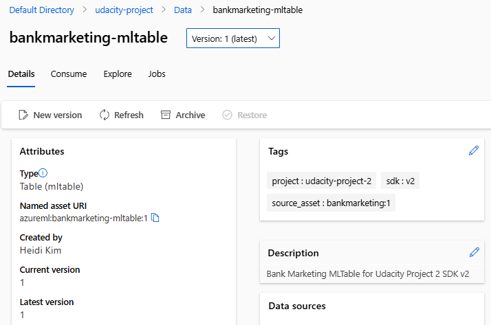

Azure ML shows `bankmarketing-mltable:1` as a registered MLTable and identifies `bankmarketing:1` as its source.

### AutoML

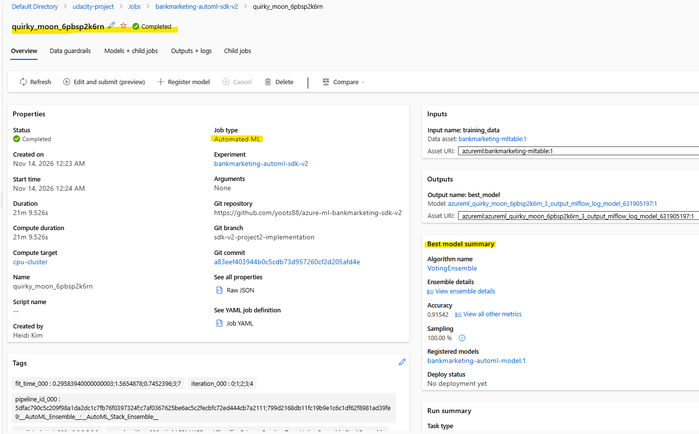

The AutoML parent completed using `bankmarketing-mltable:1`. Its best-model summary shows **VotingEnsemble** and **0.91542 accuracy**.

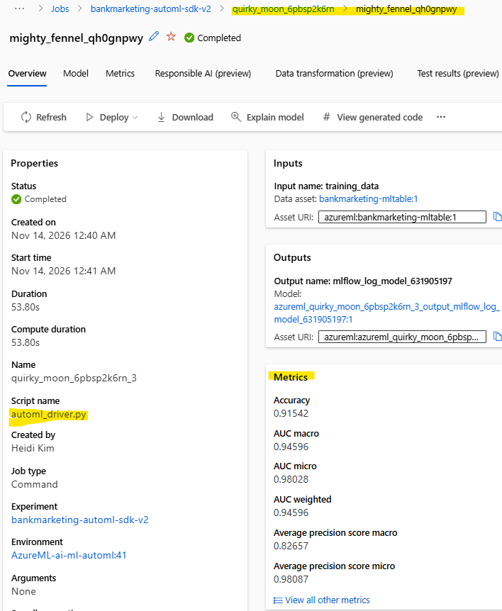

The winning child `quirky_moon_6pbsp2k6rn_3` completed with **0.91542 accuracy** and **0.94596 weighted AUC**.

### Deployment and logs

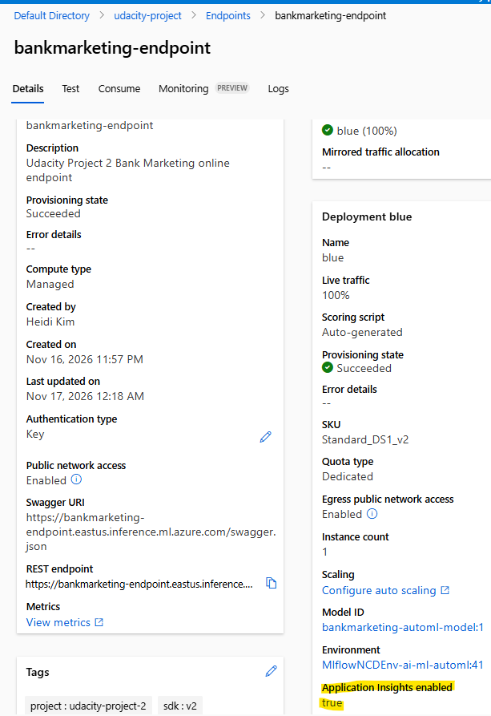

Deployment `blue` succeeded, serves `bankmarketing-automl-model:1`, receives 100% of traffic, and has Application Insights enabled.

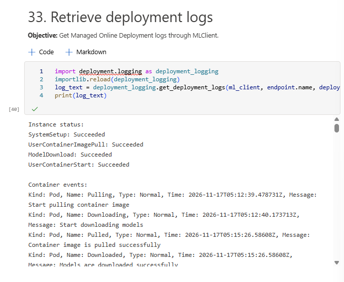

Notebook section 33 uses `deployment/logging.py` to retrieve deployment logs, including successful model download and container startup.

### Scoring

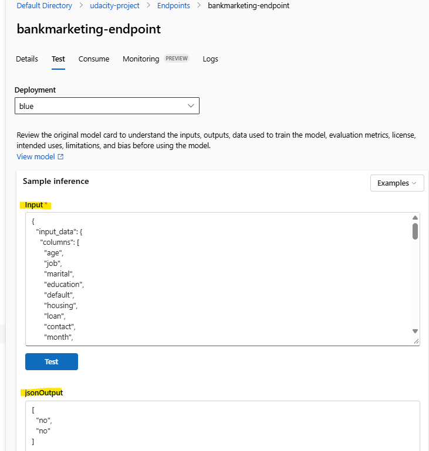

The Studio **Test** tab shows the JSON input and two returned predictions, `["no", "no"]`. Notebook section 34 also records the prediction using `deployment/scoring.py`.

### Pipeline and batch endpoint

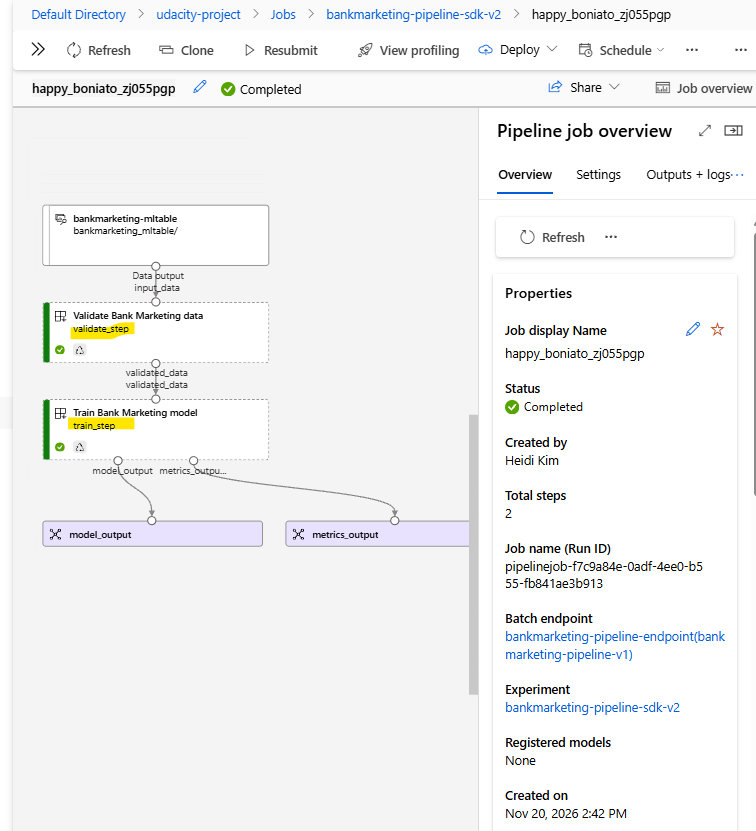

The reused, endpoint-associated job ending in `b913` shows Bank Marketing input and both completed steps, `validate_step` and `train_step`.

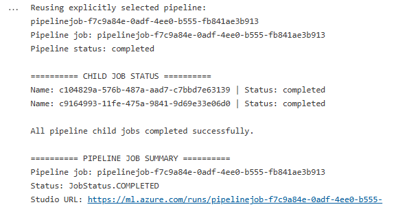

Notebook section 42–45 reports the same parent job ending in `b913` and two completed child jobs.

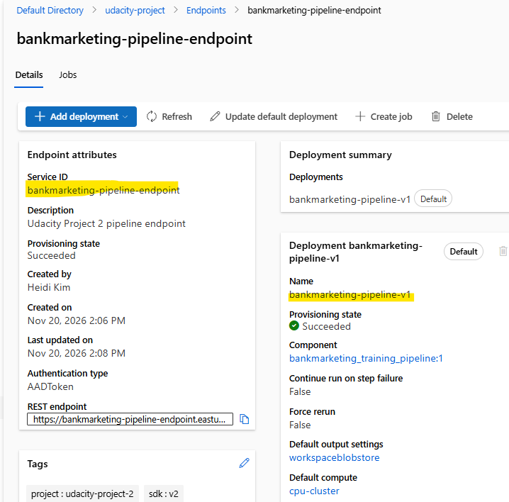

The batch endpoint succeeded and uses `bankmarketing-pipeline-v1` as its default deployment for `bankmarketing_training_pipeline:1`.

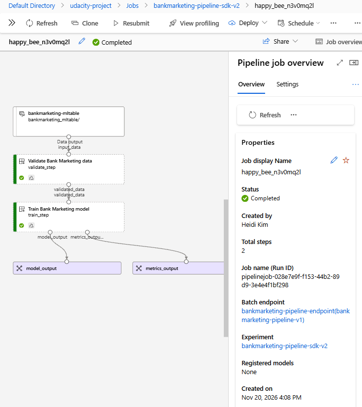

The separate invocation ending in `f298` completed both steps. Studio shows the batch endpoint and deployment that launched it.

### Schedule

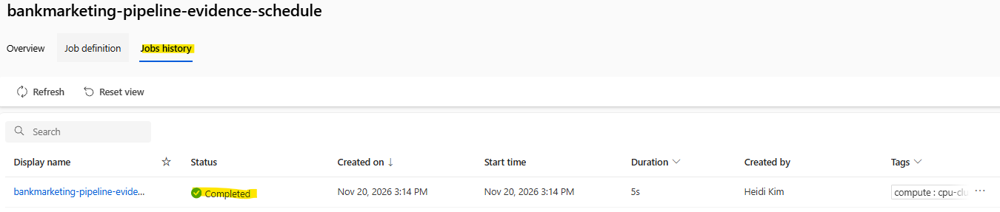

Jobs history for `bankmarketing-pipeline-evidence-schedule` shows a completed run at 3:14 p.m. on November 20, 2026.

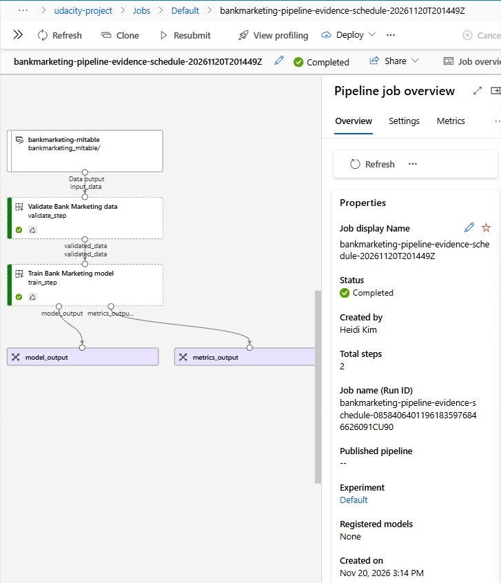

The matching scheduled job ending in `CU90` completed both steps. Its job detail shows the same creation time as the history row.

### Screencast

**Screencast link:** Pending recording.

Aim for four minutes, with readable text and clear narration in 1080p or higher at 16:9. Show the data and AutoML winner, then run a live JSON scoring request. Show the completed pipeline, the batch endpoint and invocation, then the completed scheduled job and disabled status. Test viewer access before adding the link.

### SDK v1 to SDK v2 evidence

| Original rubric item | Evidence in this project |
| --- | --- |
| Registered dataset and AutoML experiment | Versioned MLTable and completed AutoML parent and child jobs |
| ACI service, logs and scoring scripts | Managed online deployment with Application Insights, notebook log retrieval and JSON scoring |
| RunDetails widget | Notebook parent and child status with the Studio job graph |
| Published pipeline and pipeline endpoint | Versioned pipeline component deployed behind a batch endpoint |
| Scheduled run | SDK v2 JobSchedule and the job shown in its history |

The published graph trains the logistic regression baseline. AutoML runs separately. Confirm with Udacity whether those two pieces together satisfy the original **AutoML module in the pipeline** item. The localhost Swagger criterion also needs confirmation. Studio lists the deployment’s Swagger URI, and the Test screenshot documents the input and output. The screenshot does not show a localhost Swagger viewer.

Mentor references for the submission feedback field: [SDK v2 grading guidance](https://knowledge.udacity.com/questions/1086493) and [Project 2 migration discussion](https://knowledge.udacity.com/questions/1086380).

## Future performance improvements

- Compare weighted AUC and precision–recall metrics on a held-out dataset. The target is imbalanced, and the pipeline baseline's current accuracy and AUC are training-set metrics.
- If the model will score customers before a call, review feature availability and retrain without fields such as call duration that are known only afterward.
- Measure p95 response time and error rate with a representative request load before tuning endpoint capacity. The ten successful notebook calls show that scoring worked for the sample.

## Key files

| Path | Role |
| --- | --- |
| [Master notebook](Project_2_Master_Notebook_SDK_v2_Working.ipynb) | Connects the foundation, AutoML, serving, pipeline and schedule steps |
| [src/settings.py](src/settings.py) | Project resource names and workflow settings |
| [deployment/](deployment/) | Request builder, scoring, logging and monitoring helpers |
| [pipeline/pipeline_definition.py](pipeline/pipeline_definition.py) | Two-step training graph and job validation |
| [pipeline/steps/](pipeline/steps/) | Data validation and baseline training scripts |
| [Pipeline registration](pipeline/component_registration.py), [batch deployment](pipeline/batch_deployment.py), [schedule](pipeline/schedule_management.py) | Pipeline publication and operationalization |
| [docs/architecture.md](docs/architecture.md) | Architecture and operational workflow |
